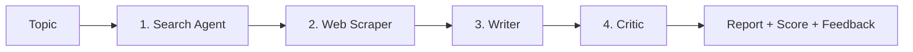

# 🔎 Multi-Agent Research System

An AI research assistant built with **LangChain** and **Groq**. Give it a topic, and a team of AI agents searches the web, reads a source page, writes a structured report with citations, and then has a critic review and score it. It comes with a **Streamlit** web interface and also runs from the command line.

## How it works



| Step | Component | What it does |
|------|-----------|--------------|
| 1 | **Search agent** | An LLM agent that uses a web search tool to find recent, relevant sources |
| 2 | **Web scraper** | Plain Python (no LLM) that extracts URLs from the search results and scrapes the first readable page, skipping blocked pages |
| 3 | **Writer** | A prompt chain that turns the research into a structured report with inline citations |
| 4 | **Critic** | A prompt chain that checks the report against the research and gives a score out of 10 with improvement suggestions |

## Features

- Multi-agent pipeline: agents for tool use, chains for writing and review
- Live progress display in the web UI
- Automatic retries when the model makes a malformed tool call
- Detection of blocked or "Access Denied" pages, with fallback to the next URL
- Critic score, strengths, and actionable improvements
- Download the final report as Markdown
- Runs on free-tier APIs

## Tech stack

- **Python 3.10+**
- **LangChain / LangGraph**: agents and prompt chains
- **Groq**: fast LLM inference
- **Tavily**: web search API
- **Streamlit**: web interface
- **python-dotenv**: environment variable management

## Project structure

```
multi_agent_system/
├── app.py            # Streamlit web interface
├── pipeline.py       # Command-line pipeline and helper functions
├── agents.py         # LLM setup, search agent, writer and critic chains
├── tools.py          # Web search and page scraping tools
├── requirements.txt  # Python dependencies
├── .env.example      # Template for API keys
└── .gitignore
```

## Setup

### 1. Clone the repository

```bash
git clone https://github.com/YOUR_USERNAME/YOUR_REPO.git
cd YOUR_REPO
```

### 2. Create and activate a virtual environment

```bash
python -m venv .venv

# Windows (PowerShell)
.venv\Scripts\Activate.ps1

# Windows (Command Prompt)
.venv\Scripts\activate.bat

# macOS / Linux
source .venv/bin/activate
```

### 3. Install dependencies

```bash
pip install -r requirements.txt
```

### 4. Add your API keys

Copy the example file and fill in your keys:

```bash
# Windows
copy .env.example .env

# macOS / Linux
cp .env.example .env
```

Then edit `.env`:

```
GROQ_API_KEY=your_groq_api_key_here
TAVILY_API_KEY=your_tavily_api_key_here
```

Get free keys here:
- Groq: https://console.groq.com
- Tavily: https://app.tavily.com

## Usage

### Web interface

```bash
streamlit run app.py
```

Open http://localhost:8501, enter a topic, and click **Start Research**.

### Command line

```bash
python pipeline.py
```

## Models

The project uses two Groq models, set in `agents.py`:

| Role | Model | Why |
|------|-------|-----|
| Search agent (tool calling) | `qwen/qwen3.8-27b` | Handles tool calls |
| Writer and critic (text only) | `openai/gpt-oss-120b` | Strong writing and reasoning |

Groq's free-tier model list changes often. If you get a `model_not_found` error, list the models your key can use and update the names in `agents.py`:

```python
from groq import Groq
import os

client = Groq(api_key=os.environ["GROQ_API_KEY"])
for m in client.models.list().data:
    print(m.id)
```

## Troubleshooting

| Problem | Cause and fix |
|---------|---------------|
| `429 rate_limit_exceeded` | You hit the free-tier tokens-per-minute limit. Wait a minute, or lower the "Max scraped characters" slider |
| `tool_use_failed` | The model produced a malformed tool call. The pipeline retries automatically; if it keeps failing, try a different model |
| `model_not_found` | The model was retired or isn't available to your key. Check the model list above |
| "Access Denied" in scraped content | Some sites block scrapers. The pipeline skips them and tries the next URL |
| Garbled characters in scraped text | Set `resp.encoding = "utf-8"` (or pass `resp.content` to BeautifulSoup) in `tools.py` |

## Limitations

- Free-tier API limits restrict how long and how often you can run research
- Only one source page is scraped per run, so reports rely mostly on search summaries
- Some websites block automated scraping
- The report quality depends on the quality of the sources found
- Always verify important facts against the original sources

## Roadmap

- [ ] Revision loop: send critic feedback back to the writer for a rewrite
- [ ] Scrape multiple pages and summarize each one
- [ ] Add academic sources (arXiv, Semantic Scholar, OpenAlex)
- [ ] Export reports to PDF
- [ ] Add a provider fallback when a model is rate-limited

## License

